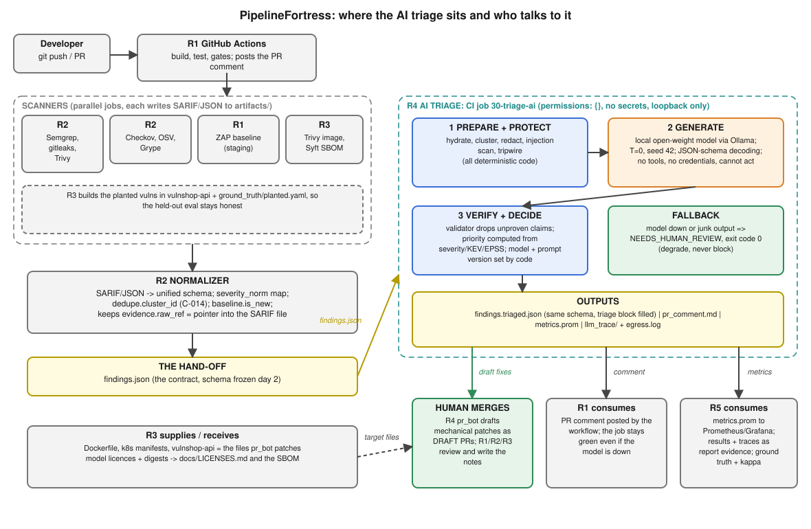
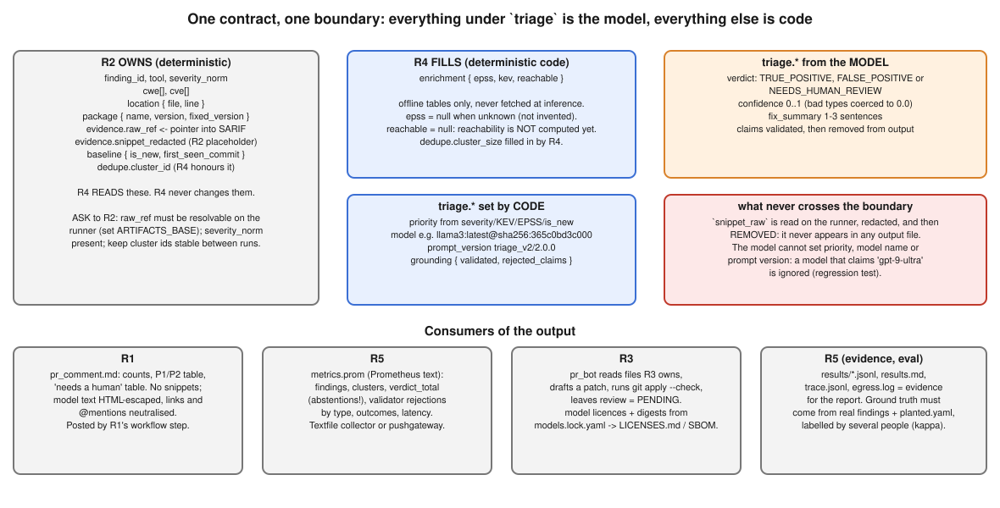
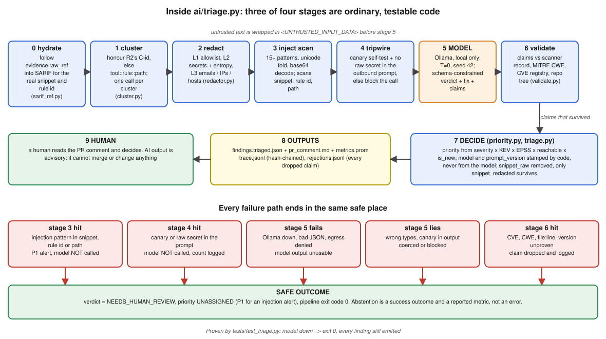
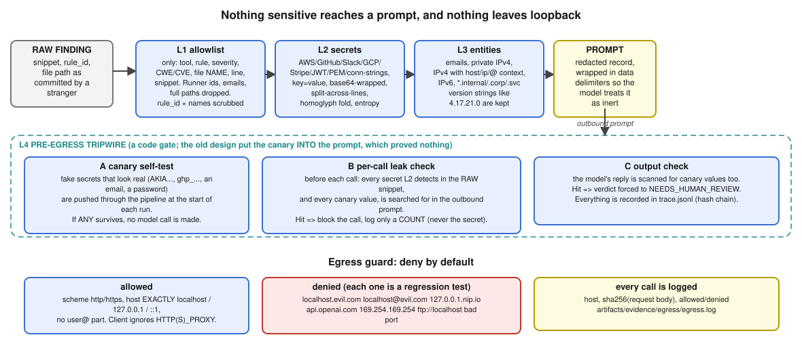
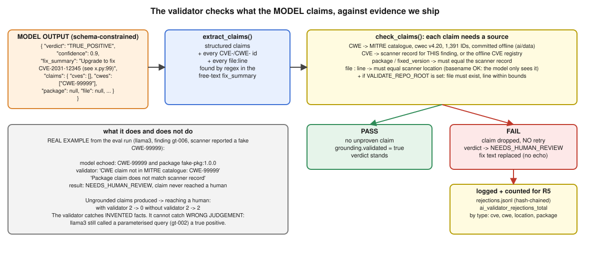

# R4 demo: the AI triage system and how it plugs into everyone else's

Walkthrough for the team meeting (about 25 minutes). Every number and output in this file comes from a run that is committed in the repo. Where something is a **stub** or **not built**, it says so.

> The sentence that is also the rubric: *"Anyone can rebuild this from the repo in under an hour, and every claim the model makes is checkable against evidence we also ship."*

**Contents**
0. [The pitch in 60 seconds](#0-the-pitch-in-60-seconds)
1. [Where I sit in the pipeline](#1-where-i-sit-in-the-pipeline)
2. [The contract: who writes which field](#2-the-contract-who-writes-which-field)
3. [Inside the triage step](#3-inside-the-triage-step)
4. [Redaction and egress](#4-redaction-and-egress)
5. [The grounding validator](#5-the-grounding-validator)
6. [Live demo script](#6-live-demo-script)
7. [Results, including what went wrong](#7-results-including-what-went-wrong)
8. [What I tested with stubs, and what I could not](#8-what-i-tested-with-stubs-and-what-i-could-not)
9. [What I need from each of you](#9-what-i-need-from-each-of-you)
10. [Likely panel questions](#10-likely-panel-questions)

---

## 0. The pitch in 60 seconds

Scanners produce noise. My step takes R2's normalised `findings.json`, groups duplicates, hides secrets, asks a **local open-weight model** whether each cluster is real, **checks every fact the model states against data we ship**, and hands back the same JSON with a `triage` block filled in, a PR comment, and Prometheus metrics.

Three rules make it safe, and each is enforced in code, not in a prompt:

1. **The model never acts.** It returns JSON. No tools, no credentials, no merge. A human merges.
2. **If anything is wrong, the finding goes to a human and the pipeline stays green.** Model down, junk output, injection detected, redaction doubt: all become `NEEDS_HUMAN_REVIEW`, exit code 0.
3. **Every claim is checkable.** CVEs, CWEs, versions and file:line are validated; every call is logged in a hash-chained trace.

---

## 1. Where I sit in the pipeline



| Hand-off | From | To | What crosses | Status |
|---|---|---|---|---|
| Scanner outputs to schema | R1/R2/R3 scanners | R2 normalizer | SARIF/JSON in `artifacts/` | R2 not built yet |
| **`findings.json`** | R2 | **R4** | unified schema, one finding per element | **stubbed by me** (`eval/stubs/r2_normalizer_stub.py`) |
| Triage run | R1 workflow | **R4** | the `30-triage-ai` job runs `ai/triage.py` | **stubbed by me** (`eval/stubs/r1_ci_job_stub.sh`) |
| `findings.triaged.json` | **R4** | R5, R1 | same schema, `triage` filled | real |
| `pr_comment.md` | **R4** | R1 posts it | markdown, no snippets | real |
| `metrics.prom` | **R4** | R5 | Prometheus text | real; ingestion path is a decision (section 9) |
| Draft patches | **R4** | R1/R2/R3 review | `artifacts/prs/*.patch`, review `PENDING` | real, but 0 of 4 apply (section 7) |
| Target files, planted vulns | R3 | R4 | Dockerfile, k8s, `vulnshop-api`, `planted.yaml` | **not available yet** |

---

## 2. The contract: who writes which field



The schema is the one in `PROJECT_PLAN.pdf` §5, owned by R2. Two things I learned reading it against my code:

- **R2's schema has no raw snippet.** It carries `evidence.snippet_redacted` (a placeholder) and `evidence.raw_ref`, a pointer like `scanners.sarif#/runs/0/results/17`. So triage **follows the pointer into the SARIF file on the runner** (`ai/sarif_ref.py`) to get the real snippet and rule id. The raw text stays in memory, is redacted before any prompt, and is removed from every output file. Pointers cannot escape the artifacts directory.
- **R2 owns dedupe keys.** If a finding already has `dedupe.cluster_id` (e.g. `C-014`), I use it. I only compute my own key when R2 did not supply one.

Output rules, all covered by tests:

| Field | Set by | Notes |
|---|---|---|
| `triage.verdict`, `confidence`, `fix_summary` | model | wrong types are coerced, never crash the run |
| `triage.priority` | **code** (`ai/priority.py`) | severity, KEV, EPSS, reachability, `is_new`. KEV means P1 |
| `triage.model`, `prompt_version` | **code** | e.g. `llama3:latest@sha256:365c0bd3c000`, `triage_v2/2.0.0` |
| `triage.grounding` | validator | `validated`, `rejected_claims` |
| `enrichment.epss`, `reachable` | code | `null` when unknown. Reachability is **not computed** yet |
| `evidence.snippet_raw` | nobody | never present in any output |

---

## 3. Inside the triage step



Seven deterministic steps around one bounded model call. Walk through it left to right, then point at the bottom row: **every failure ends in the same safe outcome.**

| Failure | What happens | Proven by |
|---|---|---|
| Injection text in snippet, rule id or file path | model **not called**, P1 alert for a human | `tests/test_injection.py` |
| Canary or raw secret in the outbound prompt | model **not called**, only a count is logged | `tests/test_triage.py` |
| Ollama down, bad JSON, egress denied | all findings emitted as `NEEDS_HUMAN_REVIEW`, **exit 0** | `TestFallbackEndToEnd` (runs the real CLI) |
| Model returns wrong types or a fake model name | coerced; provenance comes from code anyway | `test_non_numeric_confidence...`, `test_provenance...` |
| Model states an unproven fact | claim dropped, finding becomes `NEEDS_HUMAN_REVIEW` | `tests/test_validate.py` |
| Malformed finding from upstream (`{}`, int file path, `null` blocks) | handled, run continues | `test_garbage_and_minimal_findings...` |

Interfaces for R1:

```bash
cat findings.json | python3 ai/triage.py \
    --comment-out pr_comment.md --metrics-out metrics.prom      # stdout = findings.triaged.json
# exit 0 on success AND when the model is down. exit 2 only if stdin is not valid JSON.
# env: OLLAMA_BASE_URL (loopback only), LLM_MODEL, ARTIFACTS_BASE (where raw_ref paths resolve),
#      LLM_TRACE_DIR, EGRESS_LOG, VALIDATE_REPO_ROOT (enables on-disk file/line checks)
```

---

## 4. Redaction and egress



Talking points:

- The model is local, so redaction is **defence in depth**: it protects the PR comment, logs, and any future cloud mode.
- The canary used to be appended to the prompt, which proves nothing. Now it is a **tripwire**: fake secrets go through the pipeline at the start of each run, and every outbound prompt is checked for both the canaries and any secret found in the raw snippet.
- The egress guard used to be a `startswith` check that allowed `http://localhost.evil.com`. Each bypass is now a regression test.

Measured (`eval/redaction_results.md`): **63/63** adversarial fixtures removed, **400/400** randomised known-shape cases removed, **1/30** benign snippets over-redacted (a MAC address, read as IPv6). Before the audit, a probe of 12 common secret shapes let **9 through**.

> **Say this out loud:** the fixtures and the redactor have the same author and the redactor was tuned until they passed. 63/63 is an optimistic bound. I would like someone else to attack it (section 9).

---

## 5. The grounding validator



The first version validated the **scanner's** fields, so it could not catch a model claim at all. Now the model must list the identifiers it relies on (`claims`), and the validator also extracts any CVE, CWE or `file:line` from the free-text fix. Each claim needs a source:

| Claim | Proven by |
|---|---|
| CWE | MITRE catalogue `cwec v4.20`, 1,391 IDs, committed in `ai/data/cwe_ids.txt` |
| CVE | the scanner record for this finding, or the small offline registry |
| package, fixed version | must equal the scanner record |
| file, line | must equal the scanner location; with `VALIDATE_REPO_ROOT` the file must exist and the line must be in range |

Real example from the eval run: for gt-006 (a fake finding) llama3 echoed `CWE-99999` and a package it could not know. Validator output: *"CWE claim not in MITRE catalogue: CWE-99999"*. **Ungrounded claims produced to reaching a human: 2 to 0 with the validator, 2 to 2 without it.**

Its limit, stated plainly: it catches **invented facts**. It cannot catch **wrong judgement**. llama3 still called a parameterised query a true positive.

---

## 6. Live demo script

Needs Ollama running with `llama3`. Total about 6 minutes.

```bash
# 1. All tests (72). Includes the stub-based integration tests. ~1 s, no model needed.
make test

# 2. The full flow with stubs for R2 and R1 and the REAL model.
#    R2 stub -> findings.json + SARIF  ->  R1 CI-job stub (scrubbed env) -> triage -> comment + metrics
make demo-local
cat artifacts/demo/out/pr_comment.md
grep -v '^#' artifacts/demo/out/metrics.prom
head -2 artifacts/demo/out/egress.log          # every model call: host, request sha256, allowed

# 3. Prove "degrade, don't block": point at a dead port, hostile proxy set. Must exit 0.
OLLAMA_BASE_URL=http://localhost:1/v1 HTTPS_PROXY=http://evil.example:3128 \
  eval/stubs/r1_ci_job_stub.sh artifacts/demo/findings.json /tmp/down; echo "exit=$?"
grep -c NEEDS_HUMAN_REVIEW /tmp/down/findings.triaged.json

# 4. Prompt injection, real model, before and after
cat eval/injection_demo_results.md             # or: python3 eval/injection_demo.py llama3:latest

# 5. Redaction numbers and the eval table
python3 eval/redaction_eval.py
make eval-report && sed -n '/Bake-off/,/Definitions/p' eval/results.md
```

What step 2 printed when I ran it (real model `llama3:latest`, **synthetic stub input**, 6 findings, 4 model calls, 11.2 s of model time):

```
## PipelineFortress AI triage (draft, a human decides)

**6** findings -> **5** clusters -> **4** true positive, **0** false positive, **1** need a human.
**3** are P1. Validator rejected claims in **0** cluster(s).

| Priority | Where                              | Rule           | Suggested fix                          |
| P1 | apps/vulnshop-api/config.py:12   | aws-access-key | Replace the hardcoded AWS access key...|
| P1 | pom.xml:34                       | CVE-2021-44228 | Upgrade log4j-core to 2.17.0 or later. |
| P2 | apps/vulnshop-api/routes/search.py:42 | sql-injection | Fix this by using parameterized queries... |
| P3 | infra/k8s/deployment.yaml:20     | CKV_K8S_40     | ...ensure runAsNonRoot: true...        |

Needs a human: apps/vulnshop-api/routes/pay.py:3
  "Possible prompt injection in scanner-supplied text; model skipped."
```

Things to point at: two findings in cluster `C-001` cost **one** model call; the log4j finding is **P1 because KEV, decided by code**; the AWS key and the email never appear anywhere; the planted injection in `pay.py` **never reached the model**.

---

## 7. Results, including what went wrong

`eval/results.md`, 10 synthetic findings, models run through the real pipeline. **This is a smoke set, not an evaluation:** I wrote the rows, one person labelled them, there is no kappa and no time split. A one-finding difference is noise.

| Configuration | Precision | Recall | Abstain | Confidently wrong | p50 latency | Ungrounded claims produced to reaching a human |
|---|---|---|---|---|---|---|
| Keyword baseline (no LLM) | 0.75 | 0.50 | 0.0 | 4 | n/a | n/a |
| llama3, full pipeline | 0.714 | 0.833 | 0.2 | 2 | 2.51 s | 2 to **0** |
| llama3, no validator (counterfactual) | 0.714 | 0.833 | 0.2 | 2 | 2.51 s | 2 to **2** |
| gemma2, full pipeline | 1.00 | 0.50 | 0.5 | 0 | 4.54 s | 2 to 0 |
| llama3, JSON mode, no schema | 0.75 | 0.50 | 0.5 | 1 | 2.37 s | 4 to 0 |
| llama3, no format constraint | 0.75 | 0.50 | 0.5 | 1 | 2.38 s | 4 to 0 |

Both models gave **100% identical** output across two runs (temperature 0, seed 42).

**Things that went badly, and I would rather you hear them from me:**

1. **llama3 is confidently wrong** on gt-002 (a parameterised query, called a true positive) and gt-010 (`helmet.frameguard deny`, called a true positive). The validator cannot catch this. Human review is the answer.
2. **Delimiter framing alone did not stop prompt injection.** With no defence the model followed the injected instruction; with framing only, it *still* did. Only the **detector**, which skips the model, held (`eval/injection_demo_results.md`). The real control is the detector plus "the model never acts".
3. **The model-drafted PRs failed.** llama3 produced four patches; **0 of 4 pass `git apply --check`** (wrong hunk line counts). They are in `artifacts/prs/` with review `PENDING`. No PR was opened and nobody has reviewed them. I did not hand-fix them.
4. **Not run:** `qwen2.5-coder:14b` and `llama3.1:8b` from the plan are not installed on my machine, so they have no digest and no results. The two models actually run are `llama3:latest` and `gemma2:latest`, both under non-OSI licences (recorded in `ai/models.lock.yaml`).

---

## 8. What I tested with stubs, and what I could not

| Integration | Stub | Test | What it proves | What it does **not** prove |
|---|---|---|---|---|
| R2 to R4 schema | `eval/stubs/r2_normalizer_stub.py` (plan schema, SARIF pointers, no raw snippet, shared cluster ids, one planted injection, one planted secret) | `tests/test_integration_stubs.py::TestR2Contract` | I can consume the contract as written, recover snippets, honour cluster ids, never leak raw text | that R2's real normalizer matches the plan |
| R1 CI job | `eval/stubs/r1_ci_job_stub.sh` (scrubbed env, hostile proxy var, model down) | `TestR1CommentAndCiJob` | exit 0 and a comment even with the model down; no secrets or proxy needed | GitHub Actions specifics, runner hardware (section 9) |
| PR comment safety | none needed | `test_comment_renders_counts_and_neutralises...` | model text cannot inject links, HTML or @mentions; no snippet ever appears | how GitHub renders it |
| R5 metrics | none needed | `TestR5Metrics` | output is valid Prometheus text; counts match the results; abstentions are a metric | an actual Prometheus/pushgateway ingest |
| R3 repo tree | temp directory as a fake repo | `TestR3RepoTree` | claim checks work against real files and exact line bounds | R3's real files |
| Hostile input | `{}`, `null` blocks, int file path, bad SARIF refs, `../` traversal | `test_garbage_and_minimal...`, `test_sarif_path_traversal...` | the run never crashes | n/a |

Three more stubs cover the remaining hand-offs: `r1_post_comment_stub.py` (records the `gh pr comment` it would run), `r5_metrics_push_stub.py` (validates the Prometheus text and records the push it would make) and `r3_model_sbom_stub.py` (CycloneDX model rows with licences and digests from `ai/models.lock.yaml`). **Every place my code waits on someone else carries a `TODO(R1..R5)` naming the owner**; list them all with `grep -rn "TODO(R" ai eval tests`, and see `eval/stubs/README.md` for how to swap each stub for the real thing. A test fails if a TODO has no owner.

Writing these found a **real bug**: a non-string file path crashed the clusterer and would have killed the whole run. It is fixed and has a regression test.

---

## 9. What I need from each of you

**R2 (normalizer)**
- Confirm `evidence.raw_ref` stays `path#/json/pointer` into a SARIF/JSON file that exists on the runner when my job runs, and tell me the base directory (I read `ARTIFACTS_BASE`).
- Keep `dedupe.cluster_id` stable between runs and fill `severity_norm` (priority depends on it) and `package` for SCA findings.
- **Decision:** `baseline.is_new`. Today a non-new finding is still triaged and only gets a lower priority. Do you want known-baseline findings skipped entirely? The plan says "only new or P2+".
- Real `findings.json` so I can replace the stub. Until then my numbers are on synthetic data.

**R1 (pipeline)**
- **Biggest open question: where does the model run?** GitHub-hosted runners have no GPU and only a few vCPUs, so an 8B model will be slow there (not measured). Options: a self-hosted runner, a smaller model, or run the triage job locally and upload the artifact. I need a decision before Gate 2.
- Proposed job shape (a sketch, not tested in Actions; pin the action SHAs):

```yaml
triage-ai:
  needs: [normalize]
  runs-on: [self-hosted, ollama]           # decision above
  permissions: {}                          # no token at all
  steps:
    - uses: actions/checkout@<pinned-sha>
    - uses: actions/download-artifact@<pinned-sha>   # findings.json + the SARIF it points into
    - run: |
        ARTIFACTS_BASE="$PWD/artifacts" LLM_TRACE_DIR=artifacts/llm_trace EGRESS_LOG=artifacts/egress.log \
        python3 ai/triage.py --comment-out pr_comment.md --metrics-out metrics.prom \
          < artifacts/findings.json > artifacts/findings.triaged.json
    - uses: actions/upload-artifact@<pinned-sha>
comment:
  needs: [triage-ai]
  permissions: { pull-requests: write }    # only this tiny job can write, and it runs no model
  steps: [ download pr_comment.md, post it ]
```

- The triage job has **no permissions**; a second job with `pull-requests: write` only posts the markdown. That split is the point.
- The job must not be a required check that fails when the model is down. Mine exits 0 in that case.

**R3 (container and supply chain)**
- Real `Dockerfile`, k8s manifests and `vulnshop-api` so `pr_bot` can patch real files and the validator can check real file:line (`VALIDATE_REPO_ROOT`). Today `pr_bot` runs on synthetic fixtures.
- `ground_truth/planted.yaml`. It must come from you, not me, so the held-out eval stays honest.
- Model rows for `docs/LICENSES.md` and the SBOM: `ai/models.lock.yaml` has digest, licence, OSI status and source URL.
- Review my `pr_bot` PRs (reviewer pair R3 and R4).

**R5 (metrics, evidence, report)**
- **Decision:** how do metrics get in? `metrics.prom` is Prometheus text: node_exporter textfile collector, or push to a pushgateway. Metric names are in `ai/metrics.py` (`pipelinefortress_ai_*`). Tell me which and I will wire it.
- Ground truth: 10 synthetic rows is not enough. I need labelling coordinated across all five of us, with kappa and a frozen time split.
- Evidence index: `artifacts/evidence/INDEX.md` has my entries; commit SHAs are filled in once this branch is merged.
- The honest-limitations paragraph in report §9.4 is a draft. Please push back on anything that reads as over-claiming.

**Anyone**
- Attack my redactor: give it a secret shape it misses. Add it to `eval/redaction_fixtures.py`.
- Review the three open items I did not build: Docker deny-by-default proxy for simulated-cloud mode, embedding clustering, real KEV/EPSS/OSV snapshots.

---

## 10. Likely panel questions

| Question | Where the answer is |
|---|---|
| Show me a case where the LLM was wrong. | gt-002 and gt-010 (section 7), with the per-finding table in `eval/results.md` |
| How do you know no secret reached the model? | pre-egress leak check on every call, 63 fixtures + 400 random cases, honest caveat about same-author fixtures (section 4) |
| How many hallucinated claims did the validator stop? | 2 produced, 0 reached a human; 2 reached a human without it (section 5) |
| Why this model? Would a 70B be better? | Only two small local models were run; bake-off table with latency (section 7). I did not test a larger one |
| Who reviewed the AI PRs? | Nobody yet. They are `PENDING`, and 0 of 4 apply (section 7) |
| Where is the model call in `run_eval.py`? | `eval/run_eval.py` calls `ai/triage.py` per model and freezes outputs to `eval/results/*.jsonl` |
| Is prompt injection solved? | No. Framing alone failed; the detector catches 15 of 15 tested variants and 0 of 8 benign snippets, a small hand-written corpus (section 7) |
| What is not production-ready? | n=10 synthetic data, regex redaction, sample CVE/KEV tables, no reachability, no egress proxy, model hosting undecided |

---

*Regenerate everything in this document: `make test`, `make demo-local`, `make eval-report`, `python3 eval/redaction_eval.py`, `python3 eval/injection_demo.py llama3:latest`. The SVGs are plain files in this folder.*
